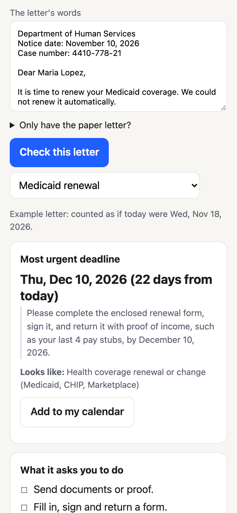

# Letter Check: what does this letter want from me?

**The problem.** People lose health coverage, benefits, money and homes because of letters they could not decode in time.
At the end of the 2023-24 Medicaid "unwinding", over 25 million people had been disenrolled, and about 69% of them lost coverage for paperwork or procedural reasons, not because they were found ineligible ([KFF](https://www.kff.org/medicaid/an-examination-of-medicaid-renewal-outcomes-and-enrollment-changes-at-the-end-of-the-unwinding/)).
And 28% of US adults scored at the lowest literacy levels (Level 1 or below) in 2023 ([NCES, PIAAC 2023](https://ies.ed.gov/learn/press-release/u-s-adults-score-par-international-average-literacy-skills-below-international-average-numeracy-and)).

**The result.** A free web page. Paste the words from a letter, bill, notice or text message and it shows:
the most urgent deadline and how many days are left (with an "Add to my calendar" button), the amount they ask for,
what it asks you to do, which documents to gather, what happens if you do nothing, your options (appeal, dispute,
payment plan, financial help), plain meanings for jargon, and scam warning signs.

It runs on your phone or computer. **Nothing you paste is sent anywhere**: no server, no account, no cookies, no tracking.
The page's security policy blocks all network requests from the script (`connect-src 'none'`).

On 32 made-up letters (Medicaid, SNAP, IRS, utility shutoff, EOB, hospital bill, debt collector, insurance denial,
eviction notice, jury summons, school, unemployment, DMV, scam texts), it now finds the right main deadline in 30 of 32
and flags all 5 scam messages without flagging any of the 27 genuine ones. Scored blind, on 16 letters written
after the rules were frozen, it got 82 of 90 checks right; details below.



## How to use it

1. Open the page (or `index.html` from this folder in any browser).
2. Paste the letter's words. Only have paper? On iPhone, point the Camera at the letter, tap the text icon, Copy All.
   On Android, use Google Lens, tap Text, Copy.
3. Tap **Check this letter**. Or pick a made-up example from the menu to see how it works.
4. Want a fuller explanation in your language? The page builds a prompt for any free AI chat (ChatGPT, Claude,
   Gemini, Copilot) with names, Social Security numbers, account numbers, emails, local phone numbers and street
   addresses removed. Read it before you paste it: that step is the only one where anything leaves your device,
   and only if you paste it yourself.

Run locally:

```sh
python3 -m http.server 8000   # then open http://localhost:8000
npm test                      # unit tests + all example letters
node scripts/evaluate.js      # rewrites results/results.md and results/results.json
```

No dependencies. Node 20+ for tests.

## How it works

Plain rules in [`src/letter.js`](src/letter.js), no AI model and no network:

- **Dates**: reads "December 10, 2026", "Dec. 10", "12/10/2026", "2026-12-10", and "within 30 days of the date of
  this letter" (counted from the letter's own date when it can find one, otherwise from today, and marked as worked
  out). Each date is sorted by the words around it into deadline, appointment, the day a change takes effect, or
  background (date of service, date of birth, tax year).
- **Amounts**: picks the amount you are asked to pay over charges, insurance payments, discounts and possible late fees.
- **Steps, documents, consequences, options**: pattern lists for the common wording of US notices.
- **Scam signs**: gift cards, crypto or payment apps, arrest threats, hour-long deadlines, requests for passwords or
  full Social Security numbers, odd links (.top, .xyz, short links), unpaid-toll and failed-delivery texts.
- **Redaction** for the optional AI prompt, and a calendar file (.ics) with a reminder 3 days before.

## Test results

All letters are made up; no real personal data. Full tables: [`results/results.md`](results/results.md).
Each letter is checked on up to six things: kind of letter, main deadline, amount, scam flag, documents, and what
happens if you do nothing.

| Set | How it was used | Letters fully right | Checks right |
|---|---|---|---|
| Build set (16) | written while building the rules | 16 of 16 | 95 of 95 |
| Held-out set (10), first blind run | written with rules frozen, scored once | 6 of 10 | 50 of 56 |
| Held-out set (10), after 3 fixes | no longer blind | 8 of 10 | 54 of 56 |
| Fresh set (6) | written after those fixes, scored once, not changed | 4 of 6 | 32 of 34 |

Blind runs combined (held-out first run + fresh set): **10 of 16 letters fully right, 82 of 90 checks right.**

What it got wrong when it had not seen the letter (from [`results/heldout-first-run.md`](results/heldout-first-run.md) and the fresh set):
- Scam texts that say "within 24 hours" or "within 48 hours" are given a deadline of today. The scam warning still
  shows first, but a date is shown for a deadline that is fake.
- "Returned within 30 days after you move out" was counted from today (fixed afterwards).
- "Citation date" was not recognised as the letter's own date, so a 30-day window was counted from today (fixed afterwards).
- Two amounts to pay were missed: "Civil penalty: $156.00" (fixed afterwards) and a "$1.99 redelivery fee" in a fake delivery text (not fixed).
- A WIC appointment letter was labelled "Appointment reminder" instead of "Food or cash benefits" (not fixed).

These are small sets that I wrote myself. They show the rules work on common US wording; they do not show how
often it is right on real letters people receive.

## Limitations

- **Not legal, medical, tax or financial advice.** It reads words with rules. It can miss a deadline, pick the wrong
  one, or miss a scam. Always check the date on the letter itself, and call the sender on a number from their
  official website.
- **English and US notices only.** Spanish and other languages are not read by the rules; the AI prompt can ask
  for an answer in 12 languages, but that answer comes from the chatbot, not this tool.
- **Counting days is approximate.** "Within 10 days" can mean from the letter date, the mailing date or the day you
  got it, and some notices skip weekends and holidays. The page says when it worked a date out.
- **A missing scam warning does not mean a message is safe.** Scams change their wording.
- **Redaction is rule-based.** It catches names after "Dear", "Patient:", "To:" and similar, labelled ID numbers,
  long numbers, Social Security numbers, emails, local phone numbers and street addresses. It will miss names and
  details written other ways. Read the prompt before you paste it anywhere.
- **No photo reading.** You copy the text from a photo with your phone's built-in tools.
- **Kinds of letter** are a best guess from keywords; Medicare, Social Security and credit card letters have no
  category of their own yet.

## Licence

MIT, (c) 2026 agentwik-labs. See [LICENSE](LICENSE).
